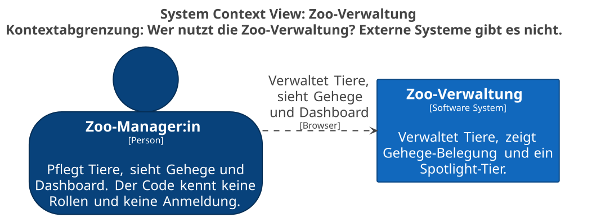

# 3. Kontextabgrenzung

> Ist-Stand, nachträglich aus dem Code abgeleitet (Branch `loesung`).

## 3.1 Fachlicher Kontext

Quelle: `diagrams/structurizr/workspace.dsl`, View `context`

| Akteur / Nachbarsystem | Austausch | Schnittstelle |
|---|---|---|
| Zoo-Manager:in | Tiere anlegen, ansehen, bearbeiten, löschen; Gehege-Belegung und Spotlight-Tier ansehen | IF-01 |

Die Zoo-Verwaltung hat **keine externen Nachbarsysteme**. Es gibt keine Anbindung an Fremdsysteme, keinen Mailversand und keinen Import.

**Offene Punkte (aus dem Code nicht klärbar):**

- Der Code kennt **keine Rollen und keine Anmeldung**. Die Specs sprechen nur von der Zoo-Manager:in, und die darf alles, auch löschen. Ist das gewollt (Workshop-App) oder eine Lücke? Der archivierte Change `animal-fact-sheet` erwähnt bereits Tierpfleger:innen als künftige Nutzer:innen.
- `AGENTS.md` nennt neben Tieren und Gehegen auch **Personal (staff)**, und die Sheriff-Konfiguration kennt eine Domäne `controlling`. Im Code existiert davon nichts. Geplanter Ausbau oder veraltete Beschreibung?

## 3.2 Technischer Kontext

| ID | Schnittstelle | Kanal | Format |
|---|---|---|---|
| IF-01 | Web-Oberfläche | Browser, HTTP auf Port 8080 | HTML/JS (Angular), ausgeliefert von der REST-API über Quinoa |

Die REST-Schnittstellen unter `/api` sind intern (Web-App ↔ REST-API) und in [Sektion 5](05-building-block-view.md) beschrieben.
