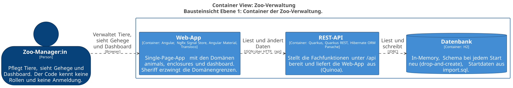
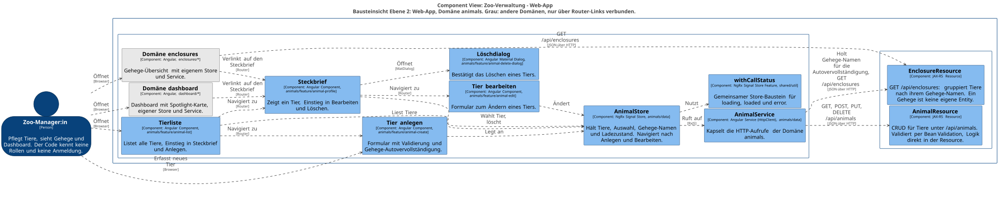
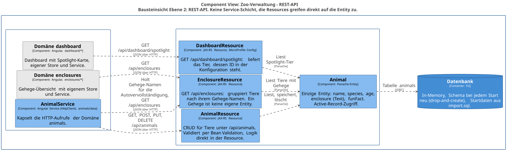

# 5. Bausteinsicht

> Ist-Stand, nachträglich aus dem Code abgeleitet (Branch `loesung`).

## 5.1 Ebene 1: Container

Quelle: `diagrams/structurizr/workspace.dsl`, View `containers`

| Baustein | Verantwortung | Schnittstellen | Technologie | Quellcode |
|---|---|---|---|---|
| Web-App | Oberfläche mit den Domänen `animals`, `enclosures`, `dashboard` | IF-01; nutzt API-01 bis API-03 | Angular, NgRx Signal Store, Angular Material, Transloco | `frontend/` |
| REST-API | Fachfunktionen unter `/api`, liefert die Web-App aus (Quinoa) | IF-01 (Auslieferung); bietet API-01 bis API-03 | Quarkus, Quarkus REST, Hibernate ORM Panache | `backend/` |
| Datenbank | Speichert Tiere, bei jedem Start neu aus `import.sql` | – (nur intern, JDBC) | H2 in-memory | `backend/src/main/resources/import.sql` |

Web-App und REST-API sind logisch getrennte Container, werden aber **gemeinsam ausgeliefert** (ein Quarkus-Prozess, siehe [Sektion 7](07-deployment-view.md) und [ADR-002](../adr/adr-002-ein-deployment-mit-quinoa.md)).

### Interne Schnittstellen

Die REST-Endpunkte sind keine externen Schnittstellen (die Web-App ist der einzige Nutzer) und tragen deshalb `API-xx` statt `IF-xx`.

| ID | Endpunkt | Anbieter | Nutzer |
|---|---|---|---|
| API-01 | `GET/POST /api/animals`, `GET/PUT/DELETE /api/animals/{id}` | AnimalResource | AnimalService (Domäne animals) |
| API-02 | `GET /api/enclosures` | EnclosureResource | Domäne enclosures, AnimalService (Gehege-Namen) |
| API-03 | `GET /api/dashboard/spotlight` | DashboardResource | Domäne dashboard |

## 5.2 Ebene 2: Web-App, Domäne animals

Quelle: `diagrams/structurizr/workspace.dsl`, View `components-spa-animals`

Die Domäne `animals` ist die fachlich reichste und steht stellvertretend für den Aufbau aller Domänen (`feature` → `data` → `model`, siehe [Sektion 8](08-crosscutting-concepts.md#modulgrenzen-mit-sheriff)).

| Bestandteil | Verantwortung | Ort |
|---|---|---|
| Tierliste, Steckbrief (`animal-profile`), Tier anlegen, Tier bearbeiten, Löschdialog | Seiten und Dialog, je eine Route bzw. ein Material-Dialog | `animals/feature/*` |
| AnimalStore | Zustand der Domäne: Tiere, Auswahl, Gehege-Namen, Ladezustand; navigiert nach Anlegen und Bearbeiten | `animals/data/animal.store.ts` |
| AnimalService | HTTP-Aufrufe gegen API-01 und API-02 | `animals/data/animal.service.ts` |
| withCallStatus | gemeinsamer Ladezustand für alle Stores | `shared/util/call-status.feature.ts` |

**Befunde:**

- Die Domäne `animals` holt Gehege-Namen über **API-02** (`/api/enclosures`), nicht über die Domäne `enclosures`. Die Domänengrenze im Frontend bleibt so sauber, die Kopplung liegt in der API.
- `enclosures` und `dashboard` verlinken per Router auf den Steckbrief. Sie importieren nichts aus `animals`.
- Das Frontend-Modell `Animal` kennt `funFact` nicht, obwohl die API es liefert. Nur das Dashboard zeigt den Fun Fact.

## 5.3 Ebene 2: REST-API

Quelle: `diagrams/structurizr/workspace.dsl`, View `components-api`

| Bestandteil | Verantwortung |
|---|---|
| AnimalResource | CRUD für Tiere (API-01), Bean Validation, Logik direkt in der Resource |
| EnclosureResource | API-02: gruppiert Tiere nach dem Text im Feld `enclosure` |
| DashboardResource | API-03: liefert das Tier mit der ID aus `dashboard.spotlight.animal-id` |
| Animal | einzige Entity (Panache, Active Record), Tabelle `animals` |

**Befunde:**

- Es gibt **keine Service-Schicht**. Die Resources greifen direkt auf die Entity zu ([ADR-003](../adr/adr-003-keine-service-schicht.md)).
- Ein **Gehege ist keine Entity**, sondern ein freier Text am Tier. „Gehege“ existiert nur als Gruppierung in API-02.
