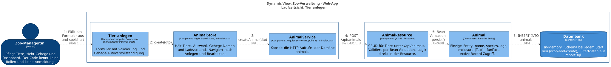

# 6. Laufzeitsicht

> Ist-Stand, nachträglich aus dem Code abgeleitet (Branch `loesung`).

## 6.1 Tier anlegen

Quelle: `diagrams/structurizr/workspace.dsl`, View `runtime-tier-anlegen`

1. Die Zoo-Manager:in füllt im Formular „Tier anlegen“ Name, Art, Alter und Gehege aus. Name und Art sind Pflichtfelder, das Gehege wird aus den bekannten Gehege-Namen vorgeschlagen (API-02).
2. Die Komponente ruft `AnimalStore.create(dto)` auf. Der Store setzt den Ladezustand auf `loading`.
3. `AnimalService.createAnimal(dto)` schickt `POST /api/animals` (API-01).
4. `AnimalResource` validiert per Bean Validation (`@NotBlank` auf `name` und `species`) und speichert mit `persist()` in einer Transaktion.
5. Die API antwortet mit `201 Created`, `Location`-Header und dem gespeicherten Tier.
6. Der Store übernimmt das Tier, setzt `loaded` und navigiert zur Tierliste.

**Fehlerfall:** Bei ungültigen Daten antwortet die API mit `400`. Der Store setzt `error`, die Seite bleibt offen.
