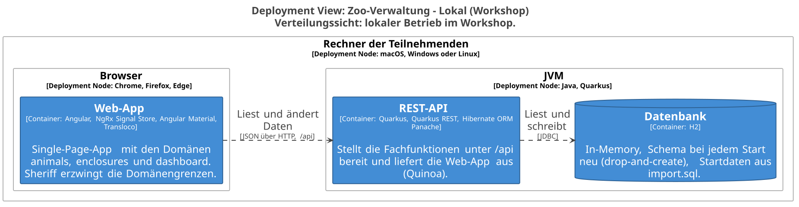

# 7. Verteilungssicht

> Ist-Stand, nachträglich aus dem Code abgeleitet (Branch `loesung`).

## 7.1 Lokal (Workshop)

Quelle: `diagrams/structurizr/workspace.dsl`, View `deployment-lokal`

| Knoten | Inhalt | Anmerkung |
|---|---|---|
| Rechner der Teilnehmenden | ein Prozess, gestartet mit `./mvnw quarkus:dev` in `backend/` | Port 8080 |
| JVM | REST-API und H2-Datenbank im selben Prozess | Quinoa startet im Dev-Modus den Angular-Dev-Server und leitet an ihn weiter |
| Browser | Web-App | lädt die App von Port 8080 |

Bausteine aus [Sektion 5](05-building-block-view.md): Web-App, REST-API, Datenbank.

**Offene Punkte:** Es gibt **nur diese eine Umgebung**. Ein Produktionsbetrieb ist nicht vorgesehen: Die Datenbank ist flüchtig ([ADR-001](../adr/adr-001-h2-in-memory.md)), es gibt kein Container-Image und keine Pipeline.
